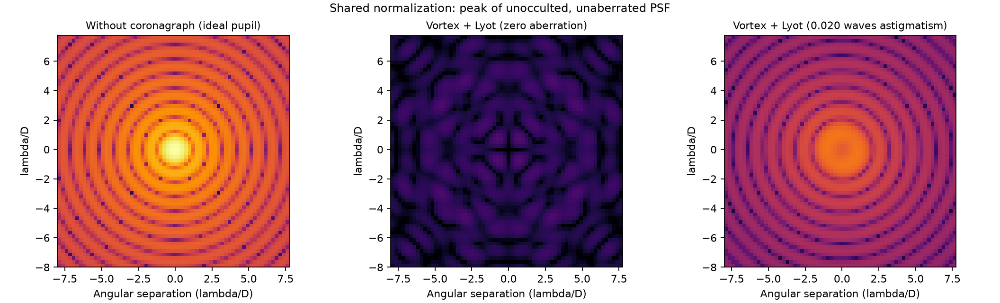
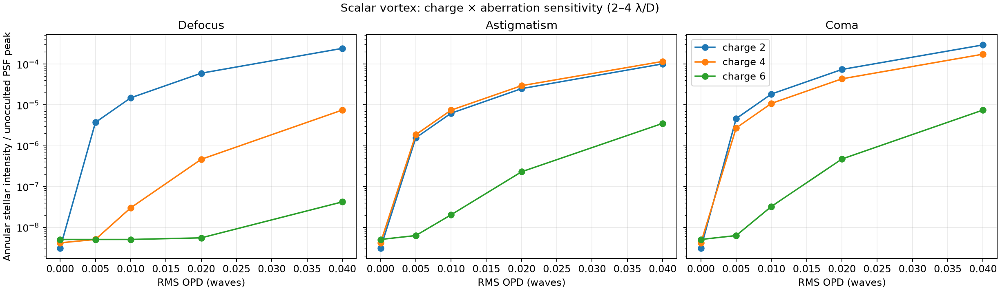
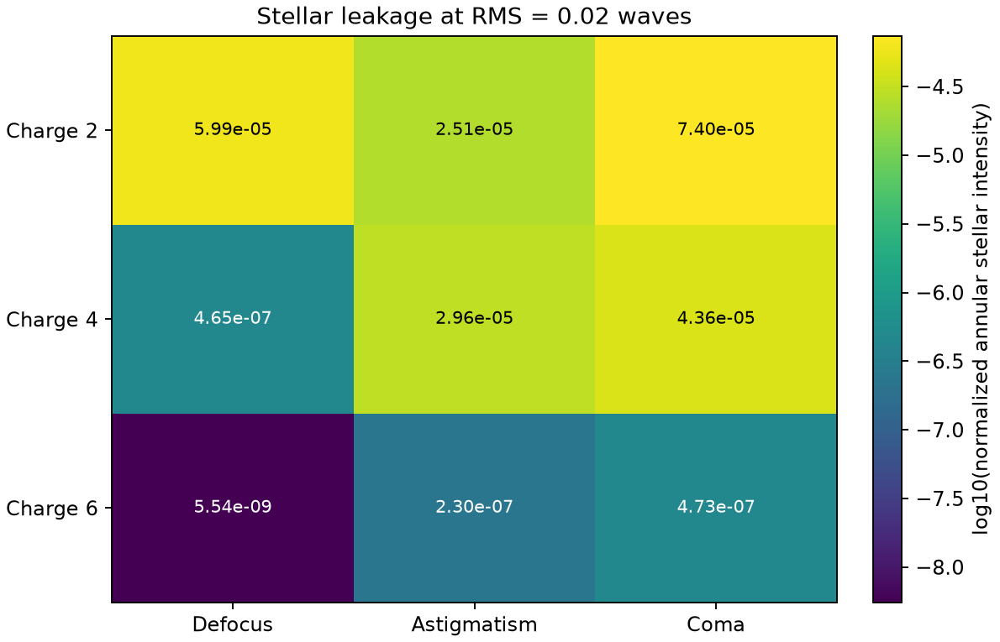
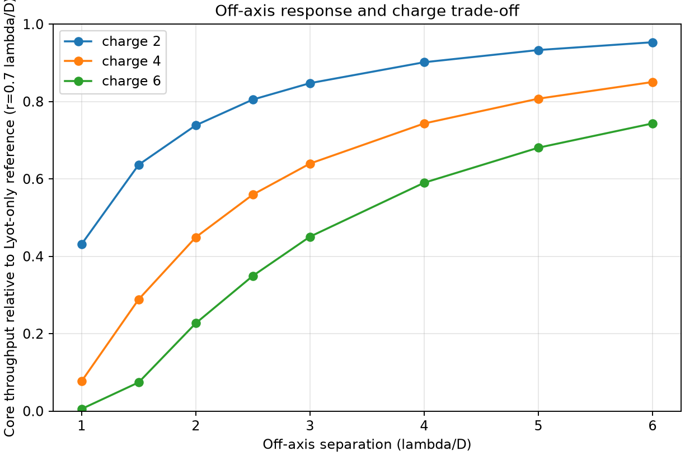
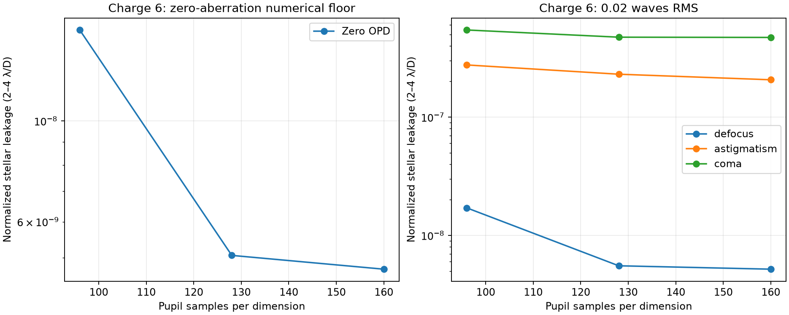

# Scalar Vortex Coronagraph: Charge and Aberration Analysis with HCIPy

**Forouzan Habibighahfarokhi** — an independent computational-optics portfolio project.

A Python study of how vortex charge affects stellar-light suppression, sensitivity to low-order wavefront errors, and off-axis throughput. The simulations compare charges 2, 4, and 6 using HCIPy's scalar diffraction model.

This project extends my work on optical simulation and field analysis toward coronagraphy. Its central question is: **how much aberration tolerance is gained by increasing vortex charge, and what is the cost in transmission close to the optical axis?**

## Optical model

The system consists of a circular entrance pupil, a scalar vortex coronagraph, a Lyot stop, and propagation to the science focal plane.

| Parameter | Configuration |
| --- | --- |
| Entrance pupil | Unobscured circular aperture, diameter D = 1 |
| Wavelength | Single wavelength, normalized to 1 |
| Vortex charges | 2, 4, 6 |
| Lyot stop diameter | 0.95 D |
| Wavefront errors | Defocus, astigmatism, coma; one mode at a time |
| RMS optical path difference | 0, 0.005, 0.01, 0.02, 0.04 waves |
| Main pupil grid | 128 × 128 samples over a width of 1.5 D |
| Science focal-plane sampling | 4 samples per λ/D |
| Charge-6 sampling check | 96, 128, and 160 samples across the grid |

The sampled aberration modes have their mean removed and are normalized to unit RMS within the pupil support before applying the selected optical path difference. Focal-plane propagation uses HCIPy's Fraunhofer propagator. No Lumerical installation is required.

## Results

### 1. Stellar suppression on a common intensity scale



The unocculted reference and charge-2 coronagraphic images share the same normalization and logarithmic color scale. This makes the reduction in stellar intensity visible without independently rescaling each image. The aberrated case shows the residual structure introduced by 0.02 waves RMS astigmatism. The nonzero signal in the zero-aberration case provides a numerical baseline.

### 2. Sensitivity to wavefront errors



Stellar leakage is the mean intensity in the **2–4 λ/D annulus**, divided by the peak intensity of the ideal, unocculted PSF without a Lyot stop. Lower values indicate stronger suppression within this region; they are not observational detection limits.

Charge 6 gives the lowest leakage for the tested nonzero aberrations. The benefit of increasing charge is mode dependent: charge 4 strongly reduces defocus leakage relative to charge 2, but its astigmatism leakage is slightly higher in this annulus. A charge comparison therefore needs both the aberration type and the measurement region.

### 3. Comparison at 0.02 waves RMS



| Vortex charge | Defocus | Astigmatism | Coma |
| --- | ---: | ---: | ---: |
| 2 | 5.99 × 10⁻⁵ | 2.51 × 10⁻⁵ | 7.40 × 10⁻⁵ |
| 4 | 4.65 × 10⁻⁷ | 2.96 × 10⁻⁵ | 4.36 × 10⁻⁵ |
| 6 | 5.54 × 10⁻⁹ | 2.30 × 10⁻⁷ | 4.73 × 10⁻⁷ |

Values are rounded from [charge_mode_leakage.csv](figures/charge_mode_leakage.csv). The charge-6 defocus result is close to the zero-aberration numerical baseline, so its absolute value should be interpreted alongside the sampling check below.

### 4. Off-axis throughput and the charge tradeoff



The throughput calculation uses an unaberrated off-axis point source. Energy is summed inside a radius of **0.7 λ/D**, centered on the corresponding reference source peak. The denominator is the energy in the same aperture for a **Lyot-stop-only reference**, so this is relative core throughput rather than absolute transmission through the entire instrument.

At a separation of **2 λ/D**, the relative core throughput is approximately **0.738, 0.449, and 0.227** for charges 2, 4, and 6, respectively. Increasing charge improves suppression for several tested wavefront errors but reduces throughput close to the axis. These results do not identify one universally optimal charge.

Source data: [charge_offaxis_throughput.csv](figures/charge_offaxis_throughput.csv).

### 5. Sampling sensitivity of the charge-6 results



This check compares zero-aberration leakage and leakage at 0.02 waves RMS as the pupil-grid resolution increases. Between 128 and 160 samples, the astigmatism result decreases by about **10.3%**, while the coma result changes by about **0.5%**. Defocus remains close to the numerical baseline.

The check supports the qualitative comparison while showing that some small residuals remain sampling sensitive. It does not establish full convergence with respect to focal-plane sampling, computational extent, or all internal vortex-propagation settings.

Source data: [charge6_convergence.csv](figures/charge6_convergence.csv).

## Scope and limitations

This is a monochromatic scalar diffraction study with an ideal circular pupil and individually applied low-order aberrations. It does not model a fabricated metasurface, polarization-dependent Jones response, broadband performance, telescope obscurations, detector noise, or active wavefront control. The reported stellar leakage and relative throughput describe this numerical model, not measured instrument performance or a planet-detection threshold.

The figures and tables above summarize the saved simulation outputs in this repository. The scripts also produce supplementary radial profiles, baseline images, and a throughput-to-leakage diagnostic; that diagnostic is not a signal-to-noise ratio or an optimized instrument design.

## Run locally

From the project folder in a VS Code terminal on Windows:

```powershell
py -V:3.12 -m venv .venv
.\.venv\Scripts\python.exe -m pip install -r requirements.txt
.\.venv\Scripts\python.exe src/coronagraph_sim.py
.\.venv\Scripts\python.exe src/validate_coronagraph.py
.\.venv\Scripts\python.exe src/compare_vortex_charges.py
.\.venv\Scripts\python.exe src/compare_charges_and_modes.py
.\.venv\Scripts\python.exe -m pytest
```


## Repository guide

| File or folder | Purpose |
| --- | --- |
| [src/coronagraph_sim.py](src/coronagraph_sim.py) | Initial single-mode coronagraph simulation |
| [src/validate_coronagraph.py](src/validate_coronagraph.py) | Shared-scale PSFs, radial profiles, aberration comparison, and sampling checks |
| [src/compare_vortex_charges.py](src/compare_vortex_charges.py) | Charge comparison and off-axis core throughput |
| [src/compare_charges_and_modes.py](src/compare_charges_and_modes.py) | Combined charge–mode study and charge-6 sampling check |
| [tests/](tests/) | Numerical helper tests |
| [figures/](figures/) | Saved figures and numerical tables |

## References

- [HCIPy documentation](https://docs.hcipy.org/)
- [HCIPy vortex coronagraph tutorial](https://docs.hcipy.org/dev/tutorials/VortexCoronagraph/VortexCoronagraph.html)
- [HCIPy source code](https://github.com/ehpor/hcipy)

HCIPy supplies the propagation and coronagraph components; the scripts in this repository set up the comparisons, calculate the metrics, and visualize the results.
